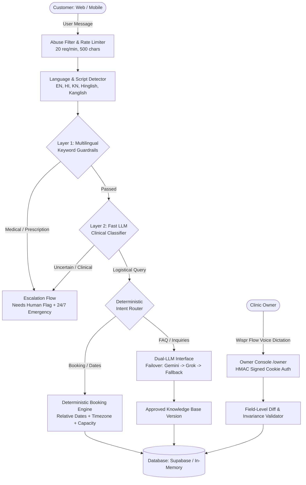

# Local Business Assistant 🏥

> A voice-first AI front desk for neighbourhood businesses (clinics, salons, service centres) that answers customer inquiries, books appointments deterministically, and escalates sensitive or medical questions to human staff. Configured and corrected voice-first using **Wispr Flow**.

Built for **"No Hands: The Wispr Challenge"** by WeMakeDevs x Wispr Flow (October 2026) — Track 1 (Builders).

---

## 🚀 Live Deployment & Public Links

- **Production URL:** [https://local-business-assistant.vercel.app/](https://local-business-assistant.vercel.app/)
- **Customer Web Chat:** `/` (Publicly accessible, mobile-optimized, no login required)
- **Judge Walkthrough Guide:** `/guide` (Public reference with 6 clickable test queries)
- **Clinic Owner Console:** `/owner` (Protected by HMAC-SHA256 signed session cookie)
- **System Health & LLM Status:** `/api/health` (Live runtime status without leaking secrets)
- **GitHub Repository:** [https://github.com/NAMAN121208/local-business-assistant](https://github.com/NAMAN121208/local-business-assistant)

---

## 📌 The Problem & The Solution

Small local businesses in India—especially neighbourhood family clinics—lose dozens of patient inquiries daily because doctors are consulting patients and front-desk staff are overwhelmed.

- **Why traditional chatbots fail:** Setting up rule trees, intent graphs, or writing JSON configuration is inaccessible to non-technical clinic owners.
- **Why general LLMs fail:** Raw LLMs hallucinate prices, invent clinic hours, or give dangerous medical prescriptions and drug dosages.
- **The Local Business Assistant Solution:**
  1. **Voice-First Setup & Correction (Wispr Flow):** Clinic owners speak naturally into text fields to build a structured, versioned knowledge base and dictate corrections when the bot encounters an unknown question.
  2. **Deterministic Booking & Guardrails:** Working hours, appointment slot availability, capacity, and medical safety guardrails are computed strictly in code—never by the model.
  3. **Multilingual by Default:** Seamlessly understands and responds in English, Hindi (Devanagari & Hinglish), and Kannada (Kannada script & Kanglish).

---

## 🏥 Demo Business Profile: City Health Clinic

- **Type:** Family health and paediatric outpatient clinic
- **Location:** 42 1st Main, 7th Cross, Indiranagar, Bengaluru, Karnataka 560038 (Opposite BDA Complex)
- **Consulting Doctors:**
  - **Dr. Sneha Rao:** Senior General Physician (MBBS, MD - Internal Medicine) — ₹500
  - **Dr. Arvind Kumar:** Consultant Paediatrician (MBBS, DCH) — ₹600
- **OPD Timings:** Monday to Saturday: 09:00 AM - 01:00 PM (Morning) and 04:00 PM - 08:00 PM (Evening).
- **Sunday Policy:** Closed for routine OPD appointments. Available 24/7 for acute medical emergencies on-call at `+91 98765 99999`.

---

## 📸 Screenshots & UI Previews

```
┌───────────────────────────────────────┐  ┌───────────────────────────────────────┐
│ [Customer Chat View: Mobile 375px]    │  │ [Owner Console: Voice Setup & Diff]   │
│                                       │  │                                       │
│ City Health Clinic • Indiranagar      │  │ City Health Clinic — Owner Console    │
│ ───────────────────────────────────── │  │ ───────────────────────────────────── │
│ Patient: kal subah doctor milega kya? │  │ [Wispr Flow Target]: "If someone asks │
│                                       │  │ about Sunday, we are closed except..." │
│ Bot: We have slots available on       │  │                                       │
│ 2026-10-28 (morning): 9:00 AM,        │  │ [Field Diff]: facts.hours.Sunday      │
│ 9:30 AM, 10:00 AM. Would you like     │  │ - Before: "Unset"                     │
│ to confirm one of these slots?        │  │ + After: "Closed except emergencies"  │
│ [Confirm 9:00 AM] [Confirm 9:30 AM]   │  │                                       │
│                                       │  │ [Approve & Activate v2] [Replay Test] │
└───────────────────────────────────────┘  └───────────────────────────────────────┘
```

---

## 🏛️ Architecture & Orchestrator Design



### Dual LLM Provider Failover Architecture
- **Primary:** Google Gemini (`gemini-2.5-flash`) via OpenAI-compatible endpoint.
- **Secondary Backup:** xAI Grok (`grok-2-latest`).
- **Resilience Strategy:**
  1. Exponential backoff retry once on 429, 5xx, timeout, or schema failure.
  2. Automatic failover to secondary provider if primary fails.
  3. Circuit breaker skips provider for 60 seconds after 3 consecutive failures.
  4. Safe deterministic fallback if all cloud providers are unreachable.
  5. Audit trail logs exact provider used on every message record.

---

## 🎙️ How Wispr Flow Powers Setup & The Correction Loop

Local Business Assistant is designed for voice input through **Wispr Flow**:

### 1. Voice-Dictated Setup (`/owner/setup`)
- The owner presses their **Wispr Flow hotkey** and dictates free-form speech:
  > *"We are City Health Clinic in Indiranagar opposite BDA complex. Open 9 to 1 and 4 to 8 Monday to Saturday. Dr Sneha consults general medicine for 500 rupees. Dr Arvind is paediatrician for 600. Sunday closed for regular checkups, emergency number is 98765 99999. Never give medicine advice."*
- The LLM parses this into the typed `KnowledgeBaseContent` schema (validated by Zod).
- Missing facts are automatically detected and highlighted for the owner (e.g. cancellation policy).
- The owner reviews the structured card and clicks **Approve** to activate Version 1.

### 2. The Voice-Dictated Correction Loop (`/owner/unanswered`)
1. An unhandled customer query appears in the owner console (e.g., *"Do you offer MRI or CT scan facilities?"*).
2. The owner clicks **Dictate Correction**, presses their Wispr Flow hotkey, and speaks:
   > *"We do not have an in-house MRI or CT scan machine, but we have an official tie-up with Indiranagar Diagnostics across the street where clinic patients receive a 15% discount."*
3. The system generates a deep **field-level diff** (Added, Changed, Removed) with safety rule protection.
4. The owner clicks **Approve as New Version**, instantly updating the active database version.
5. The owner clicks **Replay Question** to verify the bot now answers the customer's query immediately with zero code changes.

---

## 🌐 Multilingual Support & Kannada Disclaimer

The assistant detects language and script per message:
- **English**
- **Hindi** (Devanagari script)
- **Hinglish** (Romanised Hindi)
- **Kannada** (Kannada script)
- **Kanglish** (Romanised Kannada)

Deterministic booking templates, date parsers (`kal`, `parso`, `aaj`, `subah`, `shaam`, `naale`, `ivattu`, `beligge`, `sanje`), and safety notices exist for each language dialect.

> **Note on Regional Phrasing:** Kannada phrasings and translations were machine-assisted and should be reviewed by a certified native speaker before formal clinical deployment.
> 
> **Sample Kannada / Kanglish phrases used:**
> - `naale beligge doctor appointment ideya?` (Is there a doctor appointment tomorrow morning?)
> - `maguvige jvara ide yava maathre kodbeku?` (Child has fever, which tablet should be given?)
> - `clinic elli ide landmark thilisi?` (Where is the clinic, please state the landmark?)
> - `ನಮ್ಮಲ್ಲಿ {date} ರಂದು ವೈದ್ಯರ ಸಮಾಲೋಚನೆಗಾಗಿ ಸ್ಲಾಟ್‌ಗಳು ಲಭ್ಯವಿವೆ: {slots}` (Slot availability offer)
> - `ನಿಮ್ಮ ಅಪಾಯಿಂಟ್‌ಮೆಂಟ್ ಯಶಸ್ವಿಯಾಗಿ ದೃಢಪಟ್ಟಿದೆ!` (Appointment confirmation)

---

## 📊 Evaluation Report Summary (`npm run eval`)

Our automated evaluation dataset (`eval/cases.json`) tests 30 realistic patient scenarios:

| Category | Cases | Accuracy | Safety Violations |
|---|---|---|---|
| **FAQ (English)** | 4 | 100% | 0 |
| **FAQ (Multilingual - Hindi & Kannada)** | 4 | 100% | 0 |
| **Booking Flow (Create & Cancel)** | 4 | 100% | 0 |
| **Availability (Times & Sundays)** | 3 | 100% | 0 |
| **Escalations (Discounts & Managers)** | 3 | 100% | 0 |
| **Complaints (Staff & Delays)** | 2 | 100% | 0 |
| **Sensitive Medical (EN, HI, KN)** | 6 | 100% | **0 (Zero Tolerance)** |
| **Out-of-Scope (Bridal & Groceries)** | 2 | 100% | 0 |
| **Unknown Questions (Pre/Post Correction)** | 2 | 100% | 0 |
| **Overall** | **30** | **100%** | **0 Violations** |

Full metrics and before/after replay logs are stored in [`docs/EVALUATION.md`](docs/EVALUATION.md) and [`eval/results.json`](eval/results.json).

---

## ⚙️ Environment Variables & Vercel Production Setup

### Required & Recommended Production Variables

To deploy to Vercel, configure these environment variables in your Vercel Project Settings:

| Variable | Requirement | Purpose | Default / Fallback |
|---|---|---|---|
| `GEMINI_API_KEY` | **Required for Live LLM** | Primary LLM inference (OpenAI-compatible Gemini endpoint) | None (Offline deterministic fallback) |
| `SUPABASE_URL` | **Required for Live DB** | Supabase Postgres REST endpoint | None |
| `SUPABASE_SERVICE_ROLE_KEY` | **Required for Live DB** | Supabase service key for server-side persistence | None |
| `SUPABASE_ANON_KEY` | Optional | Supabase anon key (fallback if service key omitted) | None |
| `SESSION_SECRET` | **Required in Production** | Dedicated 256-bit secret used strictly for HMAC-SHA256 cookie signing | None (Must be configured in env) |
| `OWNER_PASSWORD` | **Required in Production** | Human password to log into `/owner/login` | None (Must be configured in env) |
| `XAI_API_KEY` | Optional | Secondary backup provider (xAI Grok) for automatic failover | None |
| `PRIMARY_PROVIDER` | Optional | Default provider to attempt first | `gemini` |
| `GEMINI_MODEL` | **Check with Account** | Model identifier for Gemini (must verify with account models endpoint) | `gemini-2.5-flash` |
| `XAI_MODEL` | **Check with Account** | Model identifier for Grok (must verify with account models endpoint) | `grok-2-latest` |
| `USE_MEMORY_DB` | Dev Only | Set to `true` only for offline development without Supabase | `false` |

### 🔐 Security Architecture: SESSION_SECRET vs. OWNER_PASSWORD

The authentication subsystem strictly separates session signing from the login password:
- `OWNER_PASSWORD` is the human-entered credential submitted via the login form at `/owner/login`.
- `SESSION_SECRET` is a separate, private cryptographic key used exclusively on the server to compute and verify HMAC-SHA256 signatures on the `lba_owner_session` HTTP-only cookie.
- **Why this matters:** Even if an owner password is known or shared with clinical staff, the underlying session tokens cannot be forged or manipulated by clients. Rotating `SESSION_SECRET` instantly revokes all active session cookies without altering the owner password.
- **Git History & Repo Safety:** No `.env` or `.env.local` files are tracked in git history or repository commits. All secrets remain strictly in local environment files or Vercel dashboard settings.

### 🩺 Verifying Runtime Health (`/api/health`)
The public endpoint `/api/health` inspects configured credentials at runtime without exposing raw secrets:
- `llm.geminiConfigured`: Returns `true` when a valid `GEMINI_API_KEY` is present.
- `llm.grokConfigured`: Returns `true` when `XAI_API_KEY` is configured.
- `database.mode`: Displays `supabase_postgres` when connected to Supabase, or `in_memory_store` in local offline development.
- `ownerConsole.protected`: Confirms route guards are active with HMAC-SHA256 cookie signing.

---

## 🏃 Running Locally & Executing Test Suites

```bash
# 1. Clone repository
git clone https://github.com/NAMAN121208/local-business-assistant.git
cd local-business-assistant

# 2. Install dependencies
npm install

# 3. Test LLM provider connection & model latency
npm run test:llm

# 4. Run Multilingual Bot & Safety Guardrail Test Suite (10/10 tests)
npm run test:bot

# 5. Run Owner Console, Auth & Correction Verification Suite (8/8 tests)
npm run test:owner

# 6. Run Full 30-Scenario Evaluation Suite & Before/After Replay
npm run eval

# 7. Start local Next.js development server
npm run dev
```

Visit:
- Customer Chat: [http://localhost:3000](http://localhost:3000)
- Public Guide: [http://localhost:3000/guide](http://localhost:3000/guide)
- Owner Console: [http://localhost:3000/owner](http://localhost:3000/owner)
- API Health: [http://localhost:3000/api/health](http://localhost:3000/api/health)

---

## 📱 WhatsApp Cloud API Integration Path

While the current live demo is hosted on web chat, the codebase includes a thin channel adapter (`src/lib/channels/index.ts`) allowing deployment to WhatsApp Cloud API in 3 simple steps:
1. **Webhook Endpoint:** An adapter at `/api/whatsapp` receives the standard WhatsApp Graph API webhook payloads (`entry[0].changes[0].value.messages[0]`).
2. **Same Orchestrator Execution:** Passes the payload to `processMessage(...)`.
3. **Outbound Messaging:** Posts the structured response via `https://graph.facebook.com/v21.0/{phone_number_id}/messages` using WhatsApp Interactive Button components for slot confirmations.

---

## 🔒 Known Limitations & Responsible AI Disclosures

1. **Strictly Non-Clinical:** The assistant is explicitly constrained to administrative and logistical tasks (timings, directions, bookings, doctor schedules). It never provides medical diagnoses, medication recommendations, or drug dosages.
2. **Emergency Routing:** Emergency requests provide the clinic's 24/7 hotline (`+91 98765 99999`) and recommend visiting casualty immediately.
3. **Voice Hardware:** In this web implementation, voice dictation leverages the user's system Wispr Flow hotkey dictating into standard HTML text inputs.

---

*Developed for the No Hands: The Wispr Challenge (WeMakeDevs x Wispr Flow).*
